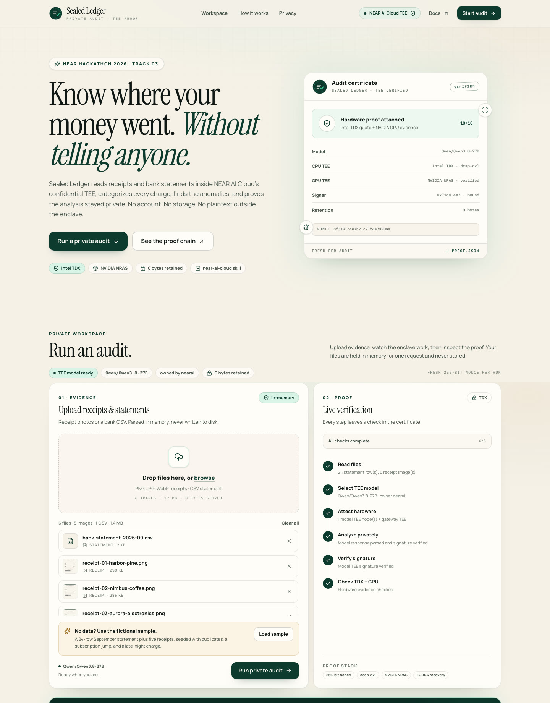
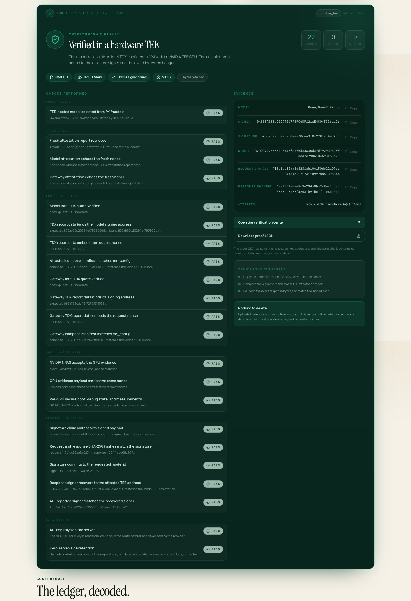
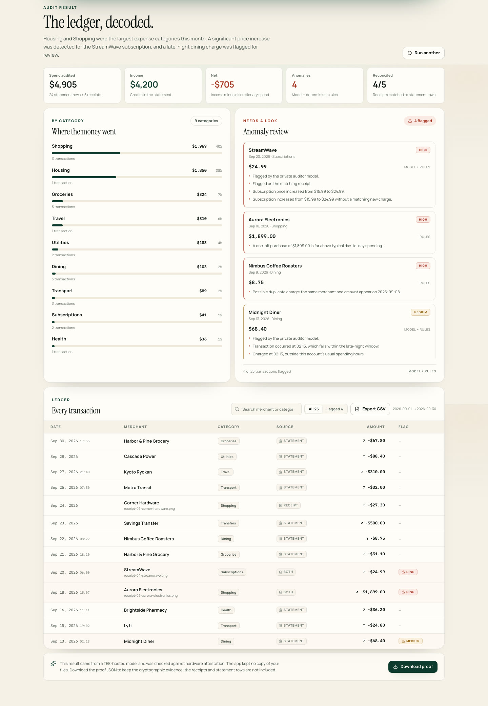

# Sealed Ledger

**Private expense audit, proven in a TEE.**

[](https://github.com/chaoticpunk/sealed-ledger/actions/workflows/ci.yml)
[](LICENSE)
[](https://sealed-ledger.vercel.app)

**Live demo:** <https://sealed-ledger.vercel.app> · **Workspace:** <https://sealed-ledger.vercel.app/app> · **Demo video (28 s):** [`docs/demo.mp4`](docs/demo.mp4)

Sealed Ledger reads receipt photos and bank-statement CSVs inside [NEAR AI Cloud](https://cloud.near.ai)'s confidential TEEs, categorizes every charge, finds anomalies, and returns a cryptographic proof that the analysis ran on genuine Intel TDX + NVIDIA hardware. Files are held in server memory for one request and never stored.

Built for **NEAR Hackathon 2026 — Track 03: Privacy & Private AI**.

## For judges

The live demo is preconfigured; no key or account is needed to inspect the UI.

1. Open <https://sealed-ledger.vercel.app/app>.
2. Click **Load sample** — a fictional 24-row statement and five receipts.
3. Click **Run private audit** and wait ~40 seconds.
4. Inspect the **Verified** panel and download `proof.json`.

From source:

```bash
npm install
cp .env.example .env.local   # add NEARAI_CLOUD_API_KEY
npm run verify:minimal       # one real completion + the full proof chain
npm run dev                  # http://localhost:3000/app
```

The byte-level verification rules are in [`docs/VERIFICATION.md`](docs/VERIFICATION.md).

```
Upload receipts / CSV
        │
        ▼
Server parses in memory ──► fresh 256-bit nonce ──► /v1/attestation/report
        │                                             │
        │                                             ├─ Intel TDX quote (dcap-qvl)
        │                                             ├─ NVIDIA NRAS GPU evidence
        │                                             └─ signing address + nonce binding
        ▼
POST /v1/chat/completions (TEE-hosted model)
        │
        ▼
GET /v1/signature/{chat_id} ──► recover ECDSA signer ──► compare to attested address
        │
        ▼
Analysis + Verified panel + proof.json
```

## Why this project

The track brief asks for a **private expense auditor** with concrete requirements. Here is how each one maps to the implementation:

| Track requirement | Where it lives |
|---|---|
| NEAR AI Cloud's OpenAI-compatible API at `https://cloud-api.near.ai/v1`, key in `.env` | `lib/nearai/client.ts`, `.env.example` |
| Select a TEE-hosted model from the models endpoint | `assertTeeHostedModel()` checks `GET /v1/models` and requires `owned_by === "nearai"` |
| Attestation report with a fresh random nonce | `randomBytes(32)` per audit in `lib/pipeline.ts` |
| Validate the report and show a **Verified** panel listing checks | `lib/nearai/verify.ts` + `components/verification-panel.tsx` |
| No server-side data after the response | In-memory `Buffer`/`FormData` only; no DB, disk writes, content logs, or cache |
| Fictional sample documents | `public/samples/` (five receipt PNGs + a 24-row CSV) |
| Use the `near-ai-cloud` agent skill; minimal script first, then UI | `.claude/skills/near-ai-cloud/`, `scripts/minimal-verify.ts` |

## What the audit does

- **Reads both sources.** CSV statements are parsed locally so amounts are never retyped by a model. Receipt images go to a vision-capable TEE model.
- **Reconciles.** A receipt that matches a statement row (merchant, amount ±$0.02, date ±2 days) becomes `both` instead of double-counting. Unmatched receipts are added to the ledger.
- **Categorizes.** The model assigns one of 15 fixed categories; deterministic local rules add reproducible anomaly checks (duplicates, large one-offs, category outliers, subscription increases, late-night charges, currency mismatches).
- **Proves.** Every result arrives with a full verification report: TDX quote status, GPU verdicts, nonce binding, request/response hashes, recovered signer, and a `proof.json` download that contains no personal data.
- **Review and export.** Search the ledger by merchant or category, filter to flagged rows, and export a CSV from the browser. The export is generated client-side; there is no server round trip.

## Screenshots

A real audit run with the committed fictional sample (22 checks passed, 0 failed, ~37 s):







Focused workspace at `/app`: [`docs/screenshots/app-workspace.jpg`](docs/screenshots/app-workspace.jpg).

Mobile layout: [`docs/screenshots/audit-mobile.jpg`](docs/screenshots/audit-mobile.jpg).
All screenshots and the recommended X crops are indexed in
[`docs/screenshots/README.md`](docs/screenshots/README.md).

## Quickstart

### 1. Get a NEAR AI Cloud API key

1. Create an account at <https://cloud.near.ai>.
2. Open **Credits** and add credits. Hackathon participants can use the [NEAR AI Cloud Credits form](https://www.notion.so/Requesting-NEAR-AI-Cloud-Credits-2deda22d7b6481aea8e1e30282efcb5e).
3. Open **API Keys** and generate a key.

Do not paste the key into chat, a commit, or a screenshot.

### 2. Configure

```bash
cp .env.example .env.local
# edit .env.local and set NEARAI_CLOUD_API_KEY
```

The default model is `Qwen/Qwen3.8-27B`, which is TEE-hosted, multimodal, and supports JSON output. To use another model, confirm it appears in `GET /v1/models` with `owned_by: "nearai"` and set `NEARAI_MODEL`.

### 3. Install and run

```bash
npm install
npm run samples      # regenerate the fictional sample documents (already committed)
npm run verify:minimal   # required track step: one completion + full attestation check
npm run dev          # http://localhost:3000
```

`verify:minimal` prints a checklist and exits non-zero if any cryptographic check fails. Paste its output into `docs/minimal-verify-output.txt` for the submission.

### 4. Run an audit

Open the app, click **Load sample** (the September statement + five receipts), then **Run private audit**. The first run may take 10–30 seconds because TDX and NVIDIA attestation are performed live. The focused workspace is also available directly at `/app`.

## Documentation

| Document | What it covers |
|---|---|
| [`docs/OVERVIEW.md`](docs/OVERVIEW.md) | Plain-language overview: problem, flow, proof chain, architecture, limits |
| [`docs/ARCHITECTURE.md`](docs/ARCHITECTURE.md) | System context, components, trust boundaries, design decisions, failure modes |
| [`docs/API.md`](docs/API.md) | `/api/audit` and `/api/health` contracts, NDJSON events, error codes |
| [`docs/VERIFICATION.md`](docs/VERIFICATION.md) | Exact verification rules, endpoint shapes, byte-hashing, independent checks |
| [`docs/DEPLOYMENT.md`](docs/DEPLOYMENT.md) | Node/Vercel deployment, env vars, limits, key rotation, access control |
| [`docs/TROUBLESHOOTING.md`](docs/TROUBLESHOOTING.md) | 402/401, model policy, attestation, signature, upload, dev/build issues |
| [`docs/DEMO.md`](docs/DEMO.md) | 3-minute demo script and X post template |
| [`docs/SUBMISSION.md`](docs/SUBMISSION.md) | Track mapping, submission fields, pre-submit checklist |

## Verification chain

The app refuses to display a result as verified unless the following chain holds:

```
NVIDIA GPU evidence
   └─ NVIDIA NRAS accepts the GPU claims and eat_nonce
        └─ Intel TDX quote (dcap-qvl) verifies the CPU TEE
             └─ TDX report_data binds the signing address + request nonce
                  └─ Chat signature recovers to that attested address
                       └─ Signed text commits to SHA-256(request) + SHA-256(response)
```

Implemented checks:

1. Model is listed by `/v1/models` and owned by `nearai`.
2. A 256-bit nonce is generated for every request.
3. Model and gateway attestation reports echo the nonce.
4. Intel TDX quote is verified with [`@phala/dcap-qvl-node`](https://github.com/Phala-Network/dcap-qvl) (Intel PCCS collateral).
5. TDX `report_data[0..32]` binds the signing address; `report_data[32..64]` embeds the nonce.
6. NVIDIA NRAS returns `x-nvidia-overall-att-result: true` and a matching `eat_nonce`.
7. Per-GPU claims pass secure boot, debug-disabled, measurement, nonce, expiry, and warning checks.
8. The attested compose manifest hash matches `mr_config` from the TDX quote.
9. Gateway TEE passes the same TDX + address + nonce checks.
10. The signature payload shape matches its declared kind (`provider_tee` = 3 fields, `gateway` = 2 fields).
11. Request and response SHA-256 hashes match the signed text.
12. The ECDSA signer recovers to the attested model/gateway TEE address.
13. The API's reported `signing_address` equals the recovered signer.

`provider_tee` is used because completions are non-streaming: the model TEE signs the exact request and response it processed. If a gateway-signed response is returned, the app verifies the gateway attestation instead.

See [`docs/VERIFICATION.md`](docs/VERIFICATION.md) for the endpoint shapes, exact byte-hashing rules, and independent verification steps.

## Zero-retention design

The privacy claim is an implementation property, not a checkbox:

- Uploads are read with `request.formData()`, copied into `Buffer`s, and passed through the pipeline. There is no database client, no ORM, no filesystem write, and no upload middleware.
- The API route streams NDJSON progress events and closes the response after the result. Nothing is queued, cached, or persisted.
- No application code logs prompt content, receipt text, model output, or file names. `grep -r "console\." app components lib` returns nothing.
- Responses use `Cache-Control: no-store`.
- There is no analytics, session, cookie, or auth layer.
- The proof JSON intentionally contains only the nonce, hashes, addresses, model id, and check results — no transactions, receipts, or personal data.
- NVIDIA NRAS only receives GPU evidence. Intel PCCS only receives TDX collateral. Neither receives user documents.

What leaves the server: the TEE request (documents included) to `cloud-api.near.ai`, GPU evidence to NVIDIA, and TDX collateral to Intel. TLS terminates inside the gateway TEE.

## Sample documents

`public/samples/` contains entirely fictional data:

- `bank-statement-2026-09.csv` — 24 transactions for "Jamie Rivera", account ****4821, with seeded duplicates, a subscription price jump, a large electronics purchase, and a 02:13 charge.
- `receipt-01-harbor-pine.png`, `receipt-02-nimbus-coffee.png`, `receipt-03-aurora-electronics.png`, `receipt-04-streamwave.png`, `receipt-05-corner-hardware.png` — generated from SVG, clearly stamped **FICTIONAL SAMPLE**.
- `samples.json` — the manifest used by the **Load sample** button.

Regenerate with `npm run samples`.

## Project structure

```
app/
  page.tsx                 landing page + product story
  app/page.tsx             focused workspace at /app
  error.tsx                branded error boundary
  not-found.tsx            branded 404
  api/audit/route.ts       streaming NDJSON audit endpoint (no retention)
  api/health/route.ts      key + model readiness, never exposes the key
components/
  auditor-app.tsx          client state machine, NDJSON reader, proof download
  upload-panel.tsx         drag/drop, sample loader, client-side image resize
  progress-rail.tsx        live pipeline steps
  verification-panel.tsx   "Verified" panel with every check + evidence
  results-view.tsx         summary, categories, anomalies, transaction table
lib/
  nearai/client.ts         OpenAI-compatible client, retries, NRAS
  nearai/verify.ts         dcap-qvl TDX, report-data binding, NRAS, compose
  nearai/chat-verify.ts    exact-byte hashing + ECDSA recovery
  audit/parse.ts           CSV parsing, dates, amounts, debit/credit columns
  audit/merge.ts           reconciliation, categories, totals
  audit/rules.ts           deterministic anomaly rules
  audit/prompt.ts          audit JSON schema + multimodal prompt
  pipeline.ts              end-to-end orchestration
scripts/
  minimal-verify.ts        track-required minimal script (one completion + proof)
  generate-samples.mjs     fictional sample generator
.claude/skills/near-ai-cloud/   vendored official skill (near/agent-skills)
```

## Scripts

| Command | Purpose |
|---|---|
| `npm run dev` | Start the Next.js app |
| `npm run build` | Production build |
| `npm run smoke` | Start a dev server on port 3100 and check `/api/health` |
| `npm run verify:minimal` | One completion + full attestation/signature walkthrough |
| `npm run samples` | Regenerate fictional receipts and statement |
| `npm test` | Unit tests for parsing, rules, merge, hashing, signature recovery, TDX binding |
| `npm run typecheck` | TypeScript only |
| `npm run lint` | ESLint |

## Testing

```bash
npm test
```

The suite covers CSV parsing (signed amounts, debit/credit columns, date heuristics), anomaly rules, receipt reconciliation, category totals, exact-byte hash comparison, ECDSA signer recovery for both signature kinds, TDX report-data binding (including TLS-fingerprint mode), compose hash comparison, and JSON-schema repair.

Cryptographic integration is exercised by `npm run verify:minimal` against the live NEAR AI Cloud API. It is intentionally separate from `npm test` so unit tests do not require a key.

## The `near-ai-cloud` skill

The official skill from [`near/agent-skills`](https://github.com/near/agent-skills/tree/main/skills/near-ai-cloud) is vendored at `.claude/skills/near-ai-cloud/`. Its verification flow, API endpoints, nonce guidance, NRAS JWT fields, and `provider_tee`/`gateway` signature rules are used directly:

- the minimal script follows the skill's "generate nonce → attestation → NRAS → completion → signature" sequence;
- the pipeline reuses the same functions for every audit request;
- the UI's checklist mirrors the skill's full verification checklist.

## Deployment notes

- Use a Node.js host that supports long-running responses. Local `next start` works out of the box.
- On Vercel, `maxDuration = 300` requires a plan that allows 300-second functions; TDX + NRAS normally completes in 10–30 seconds. Route-handler request bodies may be capped at 4.5 MB on serverless — the browser downscales large images, and the fictional sample is under 1 MB per image.
- Set `NEARAI_CLOUD_API_KEY` in the host's environment, never in the repository.
- Set `NEXT_PUBLIC_REPO_URL` to the public repository so the header/footer source links work.
- Set `NEXT_PUBLIC_SITE_URL` to the public origin before building so `og.png` resolves for X / Open Graph crawlers.

## Honest limitations

- The ECDSA and TDX verification is real. NVIDIA JWT signature verification is delegated to NRAS over TLS (the same trust model as NVIDIA's reference flow); Sigstore provenance and TLS-fingerprint binding are not implemented in this demo.
- The model can still be wrong about a merchant or category. The deterministic rules are shown separately (`model`, `rules`, or `both`) so judges can see which layer flagged what.
- This is not financial, tax, or legal advice.
- Do not upload real receipts to a public demo deployment you do not control. The sample data exists precisely so nobody has to.

## Submission

The hackathon submission materials and checklist live in
[`docs/SUBMISSION.md`](docs/SUBMISSION.md). The 3-minute demo script and X post
template are in [`docs/DEMO.md`](docs/DEMO.md).

## Contributing

See [`CONTRIBUTING.md`](CONTRIBUTING.md) for setup, checks, and the privacy
invariants. Report security issues privately as described in
[`SECURITY.md`](SECURITY.md).

## License

MIT. Sample documents are fictional and may be reused for testing.
