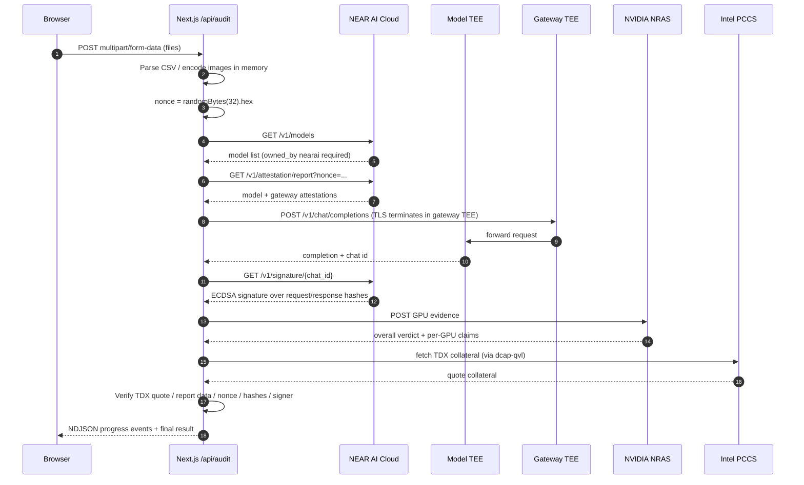

# Architecture

This document describes how Sealed Ledger is put together, where trust boundaries
sit, and why the verification path is shaped the way it is. For the byte-level
verification rules, see [`VERIFICATION.md`](VERIFICATION.md). For the HTTP
contract, see [`API.md`](API.md).

## 1. System context

```
┌─────────────┐   multipart/form-data   ┌──────────────────┐
│   Browser   │ ──────────────────────► │  Next.js server  │
│  (React)    │ ◄────────────────────── │  /api/audit      │
└─────────────┘   NDJSON progress/result└────────┬─────────┘
                                                 │ TLS
                                                 ▼
                                    ┌────────────────────────┐
                                    │  NEAR AI Cloud gateway │
                                    │  (gateway TEE)         │
                                    └───────────┬────────────┘
                                                │
                                                ▼
                                    ┌────────────────────────┐
                                    │  Model TEE             │
                                    │  Intel TDX + NVIDIA GPU│
                                    │  Qwen3.8-27B           │
                                    └───────────┬────────────┘
                                                │
                          ┌─────────────────────┼─────────────────────┐
                          ▼                     ▼                     ▼
                  ┌──────────────┐      ┌──────────────┐      ┌──────────────┐
                  │ NVIDIA NRAS  │      │ Intel PCCS   │      │ NEAR AI      │
                  │ GPU evidence │      │ TDX collateral│     │ signature API│
                  └──────────────┘      └──────────────┘      └──────────────┘
```

The browser never talks to NEAR AI Cloud directly. It only sends files to the
Next.js route and receives progress events plus the final result.

## 2. Components

| Layer | Files | Responsibility |
|---|---|---|
| Page / UI | `app/page.tsx`, `app/app/page.tsx`, `components/*` | Product story, focused workspace at `/app`, progress, results, Verified panel |
| Audit route | `app/api/audit/route.ts` | Accept multipart uploads, stream NDJSON, map errors |
| Health route | `app/api/health/route.ts` | Key configured? Model listed? TEE-hosted? Never exposes the key |
| Pipeline | `lib/pipeline.ts` | Orchestrates parse → model policy → nonce → attestation → completion → signature → hardware verification → merge |
| NEAR AI client | `lib/nearai/client.ts` | OpenAI-compatible calls, retries, NRAS, timeouts |
| Verification | `lib/nearai/verify.ts`, `chat-verify.ts` | dcap-qvl TDX, report-data binding, NRAS claims, compose hash, exact-byte hashing, ECDSA recovery |
| Audit logic | `lib/audit/*` | CSV parsing, reconciliation, deterministic rules, prompt/schema, totals |
| CLI proof | `scripts/minimal-verify.ts` | Runs the same chain once from the command line |

## 3. Request sequence



## 4. Trust boundaries

| Party | Sees | Does not see |
|---|---|---|
| Browser | The files before upload, the final analysis, the proof JSON | The API key, server memory, the TEE prompt plaintext after upload |
| Next.js server | File plaintext in memory for the duration of one request | Persistence: no DB, disk writes, content logs, or cache |
| NEAR AI gateway TEE | The request inside the enclave; TLS terminates here | Nothing usable after the response; no storage |
| Model TEE | The prompt and documents for inference | The API key is not needed inside the model |
| NVIDIA NRAS | GPU evidence payload only | Receipts, statement rows, prompt text |
| Intel PCCS | TDX collateral only | Receipts, statement rows, prompt text |

The app's privacy claim is about **server-side retention** and **hardware
attestation**, not about the model's internal behavior. See
[`OVERVIEW.md`](OVERVIEW.md) for the honest limitations.

## 5. Key design decisions

### 5.1 CSV is parsed locally

Amounts and dates are never re-typed by the model. `lib/audit/parse.ts` handles
signed amounts, separate debit/credit columns, date heuristics, and currency
inference. The model receives structured rows plus receipt images, and returns
categories/flags; `lib/audit/merge.ts` computes totals deterministically.

**Why:** a vision model reading a 24-row statement is slower, more expensive,
and more error-prone than a parser. It also makes the totals reproducible.

### 5.2 A fresh nonce per audit

`randomBytes(32)` is generated for every request. It must appear in:

- each model attestation's `request_nonce`
- the gateway attestation's `request_nonce`
- NVIDIA's `eat_nonce`
- TDX `report_data[32..64]`

**Why:** a valid but old attestation cannot be replayed against a new request.

### 5.3 Exact wire bytes are hashed

`sendChatCompletion` returns the exact response string and keeps the exact
request string that was sent. `verifyChatSignature` hashes those strings, not a
re-serialized object.

**Why:** `JSON.stringify` ordering, whitespace, and escaping can differ between
client and server. The TEE signs bytes; the verifier must hash the same bytes.

### 5.4 `provider_tee` vs `gateway` signatures

Completions are non-streaming, so the model TEE signs the exact request and
response it processed (`provider_tee`). If the gateway signs instead, the
verifier checks the gateway attestation and gateway address.

**Why:** both shapes are valid, but they bind different signers. The app
accepts both and verifies the matching attestation.

### 5.5 Signature failure aborts; hardware failure marks unverified

- If the chat signature does **not** recover to an attested address, the
  pipeline throws and discards the result.
- If a hardware check (TDX, NRAS, compose) fails, the result is returned with
  `verification.verified === false` and the UI labels it unverified.

**Why:** a result whose bytes cannot be tied to the signer is not worth showing.
A result with a failed hardware check may still be useful, but it must never be
presented as verified.

### 5.6 No persistence layer

The route reads `request.formData()`, copies file bytes into `Buffer`s, passes
them through the pipeline, and closes the stream. There is no database client,
no filesystem write, no content logger, and no response cache. Restarting the
server loses nothing.

**Why:** the privacy claim is an implementation property, not a policy page.

### 5.7 dcap-qvl stays external

`next.config.ts` includes `serverExternalPackages: ["@phala/dcap-qvl-node"]`.
The package uses native/WASM assets that should not be bundled.

**Why:** bundling it can break quote verification at runtime.

### 5.8 Next.js 16 constraints

`cacheComponents` is enabled. Do **not** add `export const runtime` or
`export const dynamic` to route files; Next 16 rejects them in this mode
(`AGENTS.md` records this).

## 6. Failure modes

| Failure | Behavior |
|---|---|
| Missing API key | NDJSON error `missing_api_key`; no result |
| 401 / 403 | NDJSON error `auth_failed`; check key |
| 402 / no spending limit | NDJSON error `insufficient_credits`; no result |
| Model not listed | Error `model_not_found` |
| Model not owned by `nearai` | Error `model_not_tee` |
| No model/gateway attestation | Pipeline throws; no result |
| Invalid chat signature | Result discarded; error |
| TDX / NRAS / compose failure | Result returned with `verified: false`; UI shows failure and checks |
| Invalid model JSON | One retry with a repair note; then error |
| Client disconnects | Stream enqueue fails silently; nothing retained |
| Upstream timeout | Fetch timeouts (20–180 s) surface as errors; route `maxDuration` is 300 s |

## 7. Extension points

- **New audit domain** (medical bills, invoices): add parsers/rules in
  `lib/audit`, change the prompt/schema, reuse the verification layer.
- **New TEE model**: set `NEARAI_MODEL` to any model listed by `/v1/models`
  with `owned_by: nearai`.
- **On-chain proof anchor**: hash `proof.json` and write only the hash + nonce
  to a NEAR contract. The current app deliberately has no chain dependency.
- **B2B compliance UX**: surface the proof JSON as an audit artifact and add
  report export; the verification layer does not need to change.

## 8. Deployment topology

The simplest production topology is a single Node.js host running
`next start` behind TLS:

```
Internet → reverse proxy (TLS) → Next.js (Node) → cloud-api.near.ai
```

The app has no database, queue, cache, or background worker. A serverless
target works with caveats; see [`DEPLOYMENT.md`](DEPLOYMENT.md).
