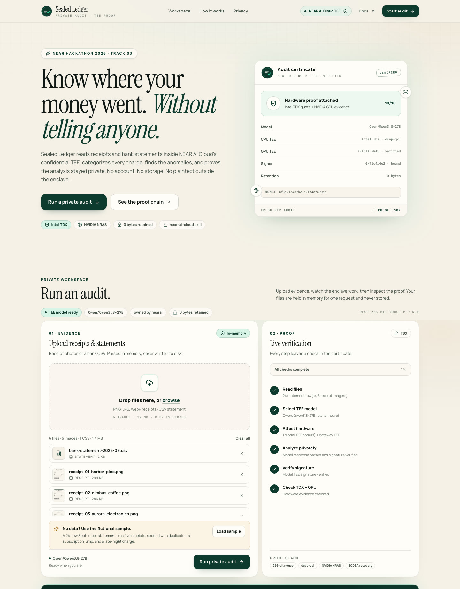
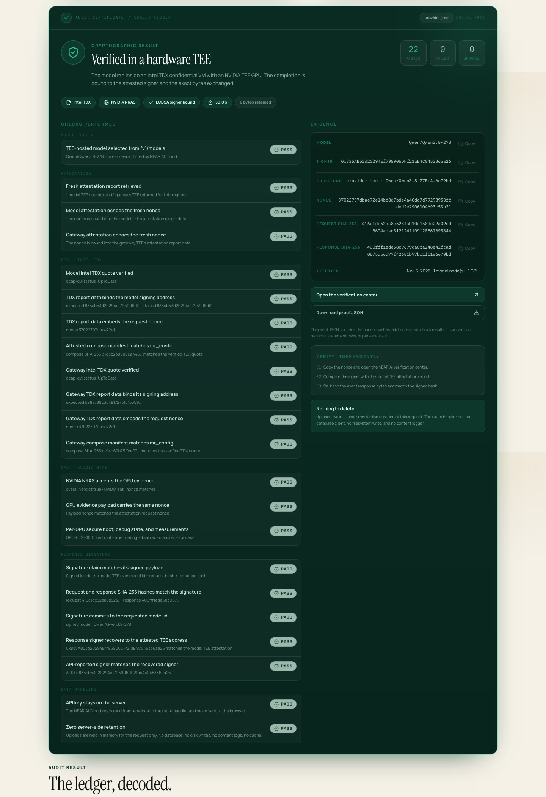
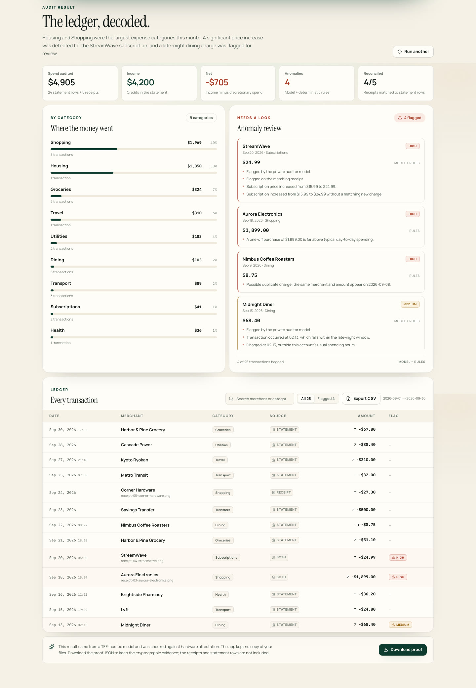

# Project overview

> **One sentence:** a private expense auditor that runs inside a hardware Trusted
> Execution Environment (TEE). Upload receipt photos and a bank statement; it
> categorizes spending, reconciles receipts, flags anomalies, and returns a
> cryptographic proof that the analysis ran on genuine Intel TDX + NVIDIA
> hardware and that no files were retained.

- Hackathon: **NEAR Hackathon 2026 — Track 03: Privacy & Private AI**
- Stack: Next.js 16, React 19, TypeScript, Tailwind CSS 4, NEAR AI Cloud
- Repository: this directory
- Verification details: [`VERIFICATION.md`](VERIFICATION.md)
- Demo script: [`DEMO.md`](DEMO.md)
- Submission notes: [`SUBMISSION.md`](SUBMISSION.md)

---

## 1. What problem does it solve?

Using AI to check your spending means handing bank statements and receipt photos
to a service provider. The usual cloud-AI trust model is:

> Upload your data to us; we promise not to store it, read it, or train on it.

You can choose to believe that, but you cannot verify it.

Sealed Ledger asks a different question: **when AI has to process data you would
not want to publish, can privacy be proven cryptographically instead of promised?**

How it answers:

- Data exists in plaintext only inside the **TEE**.
- Model output is covered by **hardware attestation and a signature**.
- The app verifies each attestation, nonce, hash, and signer address.
- Only when every check passes does it show **Verified** and offer `proof.json`.
- The server has no database, disk writes, content logs, or response cache.

In other words:

> Normal AI: hand over your data, then **trust** that it was not leaked.
> Sealed Ledger: hand over your data, then **verify** that it was not leaked.

## 2. What it actually does

### Inputs

- Receipt photos: PNG / JPG / WebP, up to 6 images
- Bank statement: CSV, with signed amounts or separate debit/credit columns
- Built-in fictional sample: 24 statement rows + 5 receipts in
  `public/samples/`, so a demo never needs real data

### Pipeline

```
Browser selects files
      │
      ▼
Next.js API route
  parse CSV / read image buffers in memory
      │
      ▼
Generate a 256-bit random nonce
      │
      ▼
GET /v1/attestation/report
  ├─ model TEE attestation (Intel TDX quote)
  ├─ gateway TEE attestation
  └─ the nonce must appear in every report
      │
      ▼
POST /v1/chat/completions
  the multimodal model inside the TEE reads receipts,
  categorizes statement rows, and flags anomalies
      │
      ▼
GET /v1/signature/{chat_id}
  recover the ECDSA signer address
      │
      ▼
Verification
  Intel TDX quote / NVIDIA NRAS / hashes / address / nonce binding
      │
      ▼
Result + Verified panel + proof.json
```

### Outputs

**1. Category summary**

Spending, income, and net across 15 fixed categories such as housing, dining,
transport, subscriptions, shopping, health, and travel.

**2. Reconciliation**

A receipt that matches a statement row (merchant, amount ±$0.02, date ±2 days)
becomes `both` instead of being counted twice. Unmatched receipts are added to
the ledger as receipt-only entries.

**3. Anomaly review**

Model judgment plus deterministic local rules. Typical flags include:

- the same merchant and amount charged twice
- a large one-off purchase
- a subscription price increase
- a late-night charge
- a category amount outlier
- a currency mismatch

Every anomaly records its source: `model`, `rules`, or `both`, so a reviewer can
see which layer flagged it.

**4. Verified panel**

The panel lists each check:

- the model is listed by `/v1/models` with `owned_by: nearai`
- model and gateway attestations echo this request's nonce
- the Intel TDX quote passes `dcap-qvl`
- TDX `report_data` binds the signing address and nonce
- NVIDIA NRAS accepts the GPU evidence and reports per-GPU claims
- the compose manifest matches `mr_config`
- request and response SHA-256 match the signed text
- the ECDSA signer recovers to an attested TEE address

**5. `proof.json`**

A downloadable proof containing the nonce, hashes, addresses, model id, and check
results. It contains **no** receipts, transaction rows, or personal data.

**6. Ledger controls**

Search by merchant or category, filter to flagged rows, and export the ledger as
CSV. The export is generated entirely in the browser; it never goes back to the
server and does not change the zero-retention design.

### A sample run

The demo script usually produces:

- about **$4,905** spend and **$4,200** income
- 4 of 5 receipts reconciled; 1 receipt-only entry
- 4 anomalies:
  - a duplicate coffee charge
  - a $1,899 electronics purchase
  - StreamWave increasing from $15.99 to $24.99
  - a Midnight Diner charge at 02:13

Model output can vary between runs, but the deterministic rule hits (duplicate,
price increase, large purchase, late-night charge) are stable.

Real screenshots from the fictional sample (22 proof checks passed):







## 3. Why the result is trustworthy

The full byte-level rules are in [`VERIFICATION.md`](VERIFICATION.md). The core
chain is:

```
NVIDIA GPU evidence
   └─ NVIDIA NRAS accepts the GPU claims and eat_nonce
        └─ Intel TDX quote (dcap-qvl) verifies the CPU TEE
             └─ TDX report_data binds the signing address + request nonce
                  └─ the chat signature recovers to that attested address
                       └─ the signed text commits to SHA-256(request) + SHA-256(response)
```

Each check answers a specific question:

| Check | Question it answers |
|---|---|
| `/v1/models` + `owned_by: nearai` | Is this a NEAR AI-hosted TEE model? |
| Fresh 256-bit nonce | Is this proof for this request, and can old proofs be replayed? |
| Intel TDX quote | Is the CPU side really inside an Intel TDX confidential VM? |
| TDX `report_data` binding | Does the report bind this signing address and nonce? |
| NVIDIA NRAS | Did GPU evidence pass NVIDIA's attestation service? |
| Per-GPU claims | Secure boot, debug disabled, measurement, nonce, and expiry? |
| Compose manifest vs `mr_config` | Does the running container configuration match the attested one? |
| Exact-byte hashes | Is the signed content the exact content sent and received? |
| ECDSA recovery | Is the signer an attested TEE address? |
| No-retention checks | Does the server really have no database, disk writes, content logs, or cache? |

**The UI shows Verified only when every non-skipped check passes.** Project rules
forbid faking a check for a demo.

## 4. Privacy design

Privacy is an implementation property, not a policy page:

- Uploads are read with `request.formData()`, copied into in-memory `Buffer`s,
  and released when the response ends.
- No database client, ORM, filesystem write, or upload middleware.
- No logs of prompts, receipt text, model output, or file names.
- Responses use `Cache-Control: no-store`.
- No analytics, sessions, cookies, or accounts.
- `proof.json` contains only the nonce, hashes, addresses, model id, and check
  results.
- NVIDIA NRAS receives GPU evidence only; Intel PCCS receives TDX collateral
  only. Neither receives user documents.

**What leaves the server:**

- the TEE request to `cloud-api.near.ai` (including documents)
- GPU evidence to NVIDIA
- TDX collateral to Intel

TLS terminates inside the gateway TEE.

> **Warning:** do not upload real receipts to a public demo deployment you do not
> control. The fictional samples exist so nobody has to.

## 5. Technical architecture

```
app/
  page.tsx                 landing page + product story
  app/page.tsx             focused workspace at /app
  error.tsx                branded error boundary
  not-found.tsx            branded 404
  api/audit/route.ts       streaming NDJSON audit endpoint (no retention)
  api/health/route.ts      key + model readiness, never exposes the key
components/
  auditor-app.tsx          client state machine, NDJSON reader, proof download
  upload-panel.tsx         drag/drop, sample loader, image resizing
  progress-rail.tsx        live verification steps
  verification-panel.tsx   Verified proof panel
  results-view.tsx         summary, categories, anomalies, ledger
lib/
  nearai/client.ts         OpenAI-compatible client, retries, NRAS
  nearai/verify.ts         dcap-qvl TDX, report-data binding, NRAS, compose
  nearai/chat-verify.ts    exact-byte hashing + ECDSA recovery
  audit/parse.ts           CSV parsing, dates, amounts, debit/credit
  audit/merge.ts           reconciliation, categories, totals
  audit/rules.ts           deterministic anomaly rules
  audit/prompt.ts          audit JSON schema + multimodal prompt
  pipeline.ts              end-to-end orchestration
scripts/
  minimal-verify.ts        minimal proof script (one completion + full chain)
  generate-samples.mjs     fictional sample generator
  smoke.sh                 health-check an existing server or start one
docs/
  OVERVIEW.md              this document
  ARCHITECTURE.md          components, trust boundaries, design decisions
  API.md                   HTTP contracts and NDJSON events
  VERIFICATION.md          byte-level verification rules
  DEPLOYMENT.md            Node / Vercel deployment and limits
  TROUBLESHOOTING.md       common failures and fixes
  DEMO.md                  3-minute demo script
  SUBMISSION.md            track mapping and checklist
```

**Key design choices**

- The model output is constrained to a fixed JSON schema; parse failures are
  repaired or retried, not accepted as free text.
- CSV is parsed locally so amounts never pass through the model.
- Anomalies are labeled `model`, `rules`, or `both`, so judges can see which
  layer found what.
- The audit endpoint streams NDJSON so the UI can show live progress.
- Nothing is persisted; restarting the server loses nothing because nothing was
  kept.

## 6. How to run

### Requirements

- Node.js ≥ 20.6 (developed on Node 24)
- A NEAR AI Cloud API key (<https://cloud.near.ai> → Credits → API Keys)

### Steps

```bash
# 1. Install
npm install

# 2. Configure the key (never commit it)
cp .env.example .env.local
# edit .env.local and set NEARAI_CLOUD_API_KEY=...

# 3. Start
npm run dev
# open http://localhost:3000
# focused workspace: http://localhost:3000/app

# 4. In the UI
#    Load sample → Run private audit
```

### Command-line verification

```bash
npm run verify:minimal
```

The script performs one real completion and prints the full checklist; any
failed cryptographic check exits non-zero. Save the output to
`docs/minimal-verify-output.txt` for the submission.

### Other commands

```bash
npm test            # unit tests (no API key required)
npm run typecheck
npm run lint
npm run build
npm run smoke       # check a running server, or start one on :3100
npm run samples     # regenerate the fictional sample files
```

### Current status (2026-11-07)

- ✅ API key configured
- ✅ Model `Qwen/Qwen3.8-27B` listed with `owned_by: nearai`
- ✅ Model and gateway attestations return, and the nonce is echoed
- ✅ `npm run verify:minimal` passes **all 27 checks**; output saved to
  [`minimal-verify-output.txt`](minimal-verify-output.txt)
- ✅ Full UI audit passes: **22 checks, 0 failures, ~37 s**
- ✅ Real screenshots in `docs/screenshots/`
- ✅ `/app` workspace, cancel audit, ledger search, CSV export, 404/error pages,
  Open Graph card
- ✅ CI workflow runs typecheck / lint / test / build
- ✅ Public repository: <https://github.com/chaoticpunk/sealed-ledger>
- ✅ Live demo: <https://sealed-ledger.vercel.app> (workspace at `/app`)
- ⏳ Remaining: public X demo post and submission form

If a new key or account returns `HTTP 402 — No spending limit configured`, see
[`TROUBLESHOOTING.md`](TROUBLESHOOTING.md#1-402--no-spending-limit-configured).

## 7. Use cases and boundaries

### Good fit

- private expense auditing and reimbursement review
- AI-assisted review of medical bills, insurance claims, and other sensitive
  documents
- enterprise finance compliance that needs a verifiable AI processing trail
- AI services that must prove "the model did not change, the data was not
  stored, the result was not altered"
- a reference implementation for verifiable private AI in other workflows

### Limitations

- **Not a consumer accounting app.** Personal bookkeeping already has mature
  products; the value here is the privacy proof, not the bookkeeping UX.
- **Not financial, tax, or legal advice.**
- **The model can still be wrong.** Merchant names and categories may be
  incorrect; deterministic rules are shown separately for review.
- **NVIDIA JWT verification is delegated to NRAS.** Sigstore provenance and
  TLS-fingerprint binding are not implemented.
- **Do not upload real data to a public demo.** The sample files exist for this
  reason.
- **It depends on live services.** If NEAR AI Cloud, NVIDIA NRAS, or Intel PCCS
  are unavailable, verification cannot complete.

## 8. Hackathon information

| Item | Value |
|---|---|
| Event | NEAR Hackathon 2026 — Build Beyond Boundaries |
| Track | 03 — Privacy & Private AI |
| Prizes | $10K / $3K / $2K for the top three in the track |
| Deadline | **2026-11-14 23:59 UTC** |
| Submission | public repository + public X demo post + form |
| Required tags | `@NEARProtocol`, `#NEARHackathon` |

See [`SUBMISSION.md`](SUBMISSION.md) for the submission checklist.

## 9. Glossary

| Term | Meaning |
|---|---|
| **TEE** | Trusted Execution Environment; plaintext is inaccessible even to the host operator |
| **Intel TDX** | Intel's confidential-VM technology, used for the CPU-side TEE |
| **NVIDIA NRAS** | NVIDIA Remote Attestation Service, which validates GPU evidence |
| **dcap-qvl** | The library used to verify Intel TDX quotes and PCCS collateral |
| **Attestation** | A hardware-generated report describing the runtime environment and configuration |
| **Nonce** | A one-time random value that prevents replay of old attestations |
| **ECDSA recovery** | Recovering the signer address from a signature and signed text |
| **`mr_config`** | The container configuration hash committed in a TDX attestation |
| **`proof.json`** | This project's exported proof file; it contains no personal data |

## 10. FAQ

**Is my data stored?**
No. Files exist in memory for the current request only; there is no database,
disk write, content log, or response cache.

**Can I view the UI without an API key?**
Yes. You can browse the page and load the sample, but a real audit requires a
key. The UI shows "API key required".

**How do I know the model was not swapped?**
The attestation binds the model id, signing address, nonce, and compose
manifest. The app trusts the result only when the ECDSA signer recovers to an
attested address.

**Does this prove the model "did not remember" my data?**
It proves where the request ran, that the request and response bytes were not
altered, who signed the result, and that the server has no retention path. It
does not prove a model cannot internally memorize data; that is a shared limit
of current TEE approaches, and the documentation states it honestly.

**Can I use real statements?**
Technically yes, but do not upload them to a public deployment you do not
control. Run it locally and assess the risk yourself; the committed samples are
fictional.

---

**Related documents**

- [README](../README.md) — project homepage
- [ARCHITECTURE.md](ARCHITECTURE.md) — system context, components, trust boundaries
- [API.md](API.md) — `/api/audit`, `/api/health`, NDJSON events, error codes
- [VERIFICATION.md](VERIFICATION.md) — verification rules and independent checks
- [DEPLOYMENT.md](DEPLOYMENT.md) — Node / Vercel deployment, env vars, limits
- [TROUBLESHOOTING.md](TROUBLESHOOTING.md) — 402/401, model, attestation, signature, upload, build
- [DEMO.md](DEMO.md) — 3-minute demo script and X post template
- [SUBMISSION.md](SUBMISSION.md) — track mapping, submission fields, checklist
